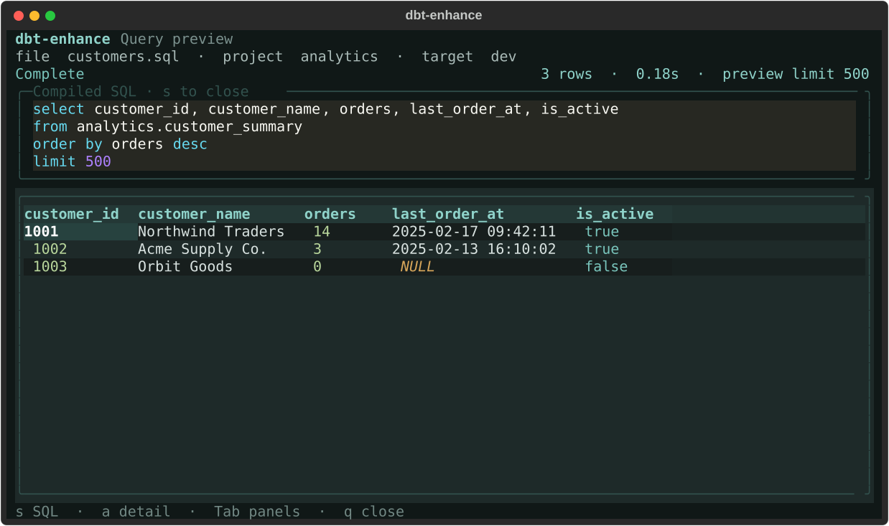

# dbt-enhance

**Select SQL in Helix. Press Space, then x. Stay in your flow.**

A tmux popup compiles your selected dbt/Jinja SQL, executes it using the nearest
parent dbt project, and shows a keyboard-friendly results table. Expand the SQL
to see the actual statement dbt executed, including its preview limit.

- Works from Helix directly or from Helix opened by Yazi.
- Runs the **selection**, including unsaved edits—not automatically the whole file.
- Finds the closest ancestor `dbt_project.yml` for every invocation.
- Uses each project's own dbt executable, adapter, profile, macros, and environment.
- Scrollable rows/columns, syntax-highlighted SQL, cell inspection, loading/error states.
- No editor plugin, daemon, separate connection manager, or bundled warehouse adapter.



## Install in one command

From this checkout:

```sh
uvx --from . dbt-enhance setup
```

This installs a persistent `uv tool`, then adds **Space-x** to both normal and
select mode in your Helix configuration. Existing settings and comments are
preserved, symlinks are followed without replacing them, and changed files get a
backup. An existing Space-x binding is **not** overwritten unless you pass `--force`.
Reload Helix with `:config-reload` or restart it.

### Share it with someone else

Once you push this repository to a Git host, give them one command, replacing the URL:

```sh
uvx --from 'git+https://github.com/YOUR-ORG/dbt-enhance.git' dbt-enhance setup
```

No clone is needed. Setup installs the same Git commit that uvx fetched. You can
also distribute a built wheel and use `uvx --from /path/to/dbt_enhance-0.1.2-py3-none-any.whl dbt-enhance setup`.

To update a Git installation, rerun that `uvx` command with `--refresh` after the
new code is pushed. Setup pins the fetched commit, so upgrading an old pinned tool
alone does not necessarily move it to the repository's latest commit.

**This repository is not published to PyPI yet.** The shorter
`uvx dbt-enhance setup` command is only appropriate after publishing this package
under that name. See [releasing](docs/releasing.md).

### Prerequisites

- macOS or Linux, [uv](https://docs.astral.sh/uv/), **Helix 25.07+**, **tmux 3.3+**.
- Helix's default POSIX shell configuration (`sh -c`). A custom Fish shell for
  Helix's `editor.shell` is not supported by the generated mapping; your login
  shell can still be Fish.
- An existing working **dbt Core** project with its warehouse adapter installed.
  Tested with Core 1.10.22, 1.12.5, and 1.12.6 plus dbt-duckdb 1.9.6. dbt Fusion and the dbt
  Cloud CLI are not supported.
- Python 3.12+ for this tool; uv can provision Python. The project's dbt Python
  version is independent.

On macOS, install missing terminal tools with `brew install tmux helix`. Setup
never installs or changes your project's dbt/warehouse dependencies.

## Use it

Start a tmux workspace, then launch your usual workflow **inside it**:

```sh
tmux new-session -A -s work
yazi  # or: hx path/to/models/orders.sql
```

1. Open a saved-path buffer inside a dbt project.
2. Select **one complete query**, which can be only part of the file. Include any
   needed CTEs, Jinja variables, and enclosing Jinja blocks in that selection.
   Helix's `%` selects the whole buffer; `x` selects the current line.
3. Press **Space, x** (lowercase x, not Shift-X).
4. Inspect the results; close the popup to return to the unchanged selection.

| Key | Action |
| --- | --- |
| Arrows / `hjkl` | Navigate result cells, scrolling rows and columns |
| Page Up / Page Down | Scroll the focused view |
| `s` | Expand/collapse compiled SQL |
| `a` | Toggle selected-cell detail |
| Tab / Shift-Tab | Move focus between visible panels |
| `q` / Esc | Close; cancel the local dbt process if still running |

The default is **500 rows** and a **120-second local timeout**. The table is a
preview, not pagination over the whole result. A result exactly at the limit may
have more rows in the warehouse. Empty results get an explicit empty state;
dbt's JSON preview does not provide column names when there are no rows.
While running, the popup shows elapsed time and the configured timeout. Its own
deadline stops the spinner even if backend cleanup is stuck; late results cannot
replace the timeout. Closing allows up to two seconds for best-effort local cleanup.

## How project connections work

Discovery starts at the **source buffer's directory**, walking upward to the
first `dbt_project.yml`, not at Helix's working directory. Nested or unrelated
projects therefore resolve independently. Symlinks resolve to their real paths.

Executable resolution is:

1. `--dbt` / `DBT_ENHANCE_DBT`, if set.
2. The project's `.venv/bin/dbt`.
3. The nearest ancestor `.venv/bin/dbt` (for monorepos).
4. `dbt` on the editor's `PATH`.

The command runs from that project's root. dbt itself chooses its profile and
default target, including `DBT_PROFILES_DIR`, `DBT_TARGET`, and environment-based
credentials. The popup receives the editor's current environment, not the tmux
server's possibly stale environment. Set environment variables **before starting
Helix/Yazi**; an already-running editor cannot inherit later shell changes.

Optional overrides work for both `query` and the shortcut:

| CLI option | Environment variable | Default |
| --- | --- | --- |
| `--limit` | `DBT_ENHANCE_LIMIT` | 500, maximum 10,000 |
| `--timeout` | `DBT_ENHANCE_TIMEOUT` | 120 seconds |
| `--target` | `DBT_ENHANCE_TARGET` | dbt's default |
| `--profiles-dir` | `DBT_ENHANCE_PROFILES_DIR` | dbt's normal discovery |
| `--dbt` | `DBT_ENHANCE_DBT` | executable discovery above |
| `--backend` | `DBT_ENHANCE_BACKEND` | `worker` (`process` for isolated queries) |

For example: `DBT_ENHANCE_TARGET=dev DBT_ENHANCE_LIMIT=1000 hx models/orders.sql`.

Queries use the project's **normal dbt target and log paths**, including
`target-path`/`log-path` settings and `DBT_TARGET_PATH`/`DBT_LOG_PATH` overrides.
They reuse and update `partial_parse.msgpack` rather than starting with an empty
temporary target directory. dbt handles cache validation and reparses changed
project files when needed; selected SQL is still compiled and executed each time.
The normal `manifest.json`, `run_results.json`, and logs are updated just as they
would be by running `dbt show` yourself.

For preview speed, the child defaults `DBT_POPULATE_CACHE=false` (equivalent to
`--no-populate-cache`), avoiding eager relation discovery across all project schemas.
Standard adapter introspection still queries on demand. If custom macros rely on
preloaded cache state, set `DBT_POPULATE_CACHE=true` before launching the editor.
This is warehouse relation discovery, **not the partial-parse cache**, which is
reused normally when dbt partial parsing is enabled.
The child also defaults `SNOWFLAKE_DISABLE_PLATFORM_DETECTION=true` to skip optional
metadata probes in connector versions supporting that option. Explicit values for
both variables are preserved; the parent environment is never changed.

### Snowflake: prefer non-interactive authentication

**Use an organization-approved non-interactive method, such as RSA key-pair
authentication, for popup queries—especially on WSL.** The popup is not an
interactive login terminal. Do not rely on completing browser SSO from a WSL
popup: browser launch reporting, callback routing, and paste-URL fallback can fail.
If your existing dbt target already uses RSA keys, dbt-enhance uses it unchanged;
there is no separate connection or authentication configuration for the tool.

For dbt Core, a key-pair target in your existing `profiles.yml` can look like this
(adapt the profile name and connection settings to your project):

```yaml
your_profile:  # Matches profile: in dbt_project.yml
  target: dev
  outputs:
    dev:
      type: snowflake
      account: your-org-your-account
      user: YOUR_DBT_USER
      role: YOUR_READ_ONLY_ROLE
      database: ANALYTICS
      warehouse: YOUR_WAREHOUSE
      schema: YOUR_SCHEMA
      threads: 4
      private_key_path: "{{ env_var('DBT_SNOWFLAKE_PRIVATE_KEY_PATH') }}"
      # For an encrypted private key; omit this field only if the key is unencrypted.
      private_key_passphrase: "{{ env_var('DBT_ENV_SECRET_SNOWFLAKE_KEY_PASSPHRASE') }}"
```

- The corresponding public key must already be registered for that Snowflake user.
  Follow your organization's key-generation, registration, and rotation policy;
  see [Snowflake key-pair authentication](https://docs.snowflake.com/en/user-guide/key-pair-auth).
- Use the existing private key file, preferably encrypted. On WSL, provide an
  absolute path readable from **inside WSL**, with restrictive file permissions.
  Never commit private keys or passphrases to the repository.
- Supply the path and passphrase through your approved environment/secret-manager
  setup **before launching Helix/Yazi**. The encrypted key must be unlockable without
  a prompt. dbt's [`DBT_ENV_SECRET_` prefix](https://docs.getdbt.com/reference/dbt-jinja-functions/env_var#secrets)
  scrubs the passphrase from dbt logs; it is not a substitute for secure storage.
- Use `private_key_path` / `private_key_passphrase` instead of `password` and remove
  `authenticator: externalbrowser` from this key-pair target. dbt-enhance does not
  generate keys, register them, or edit your profiles.

Key-pair auth removes browser interaction and SSO waits. It does **not** remove
Python/dbt startup, warehouse connection setup, query execution, or result fetching.
It improves predictability; the timing benefit depends on where your query spends time.

#### Browser SSO fallback (not recommended for WSL popups)

`authenticator: externalbrowser` can work when the browser opens and its callback
reaches the connector, but dbt runs with **no interactive stdin**: the popup cannot
accept a pasted redirect URL. If your organization requires browser SSO, complete
login outside the popup and arrange approved token caching. Recognized SSO prompts
get a safe status message; login URLs and tokens are not forwarded as progress.

If login fails, expires, or stalls, open a normal terminal **in the same WSL/Linux
or macOS environment** and use the project's resolved dbt executable:

```sh
cd /path/to/dbt/project
# Use the same executable, target and profiles directory as the popup:
.venv/bin/dbt debug
.venv/bin/dbt show --inline 'select 1 as ok' --limit 1 --no-populate-cache
```

Complete any browser/paste-URL interaction there, then retry. This only carries
across separate dbt processes if **approved SSO token caching is working**:

- Your Snowflake administrator must allow ID-token caching (`ALLOW_ID_TOKEN`),
  consistent with your organization's security policy.
- The connector needs `client_store_temporary_credential` enabled. dbt-snowflake
  versions already enable it for configured authenticators; adding a similarly
  named profile key alone does not guarantee working caching.
- Local credential storage must work for the installed connector version and OS.
  Older Linux/WSL connector versions may need `secure-local-storage`/keyring setup;
  consult [Snowflake's caching requirements](https://docs.snowflake.com/en/user-guide/admin-security-fed-auth-use#using-connection-caching-to-minimize-the-number-of-prompts-for-authentication-optional).

The tool never changes profiles, caches credentials itself, or alters account
security settings. Do not paste authentication URLs or tokens into bug reports.
To check timeout behavior, use `dbt-enhance query --file models/example.sql
--sql 'select 1' --timeout 15`; the popup should show a timeout instead of spinning
indefinitely, even when authentication has not completed.

## Warm worker (default)

The default `worker` backend keeps **both Python/dbt and the adapter's live connection**
open between queries. It uses dbt's own inline parsing, compilation, and
adapter-dispatched preview SQL—not a handwritten `ref()`/`source()` resolver.

No opt-in is needed, including in Helix/Yazi. To use a fresh dbt command per
selection instead, set `DBT_ENHANCE_BACKEND=process` before starting your editor,
or pass `--backend process` for one invocation.

For example:

```sh
dbt-enhance query --backend worker --file /absolute/project/models/model.sql \
  --sql 'select {{ 6 * 7 }} as answer' --json
```

- The first request still imports dbt and authenticates. Later requests reuse the
  process and connection, while native partial parsing checks project/model/macro
  changes and **each selection is freshly compiled and executed**.
- Compiled SQL comes directly from the native execution result. Worker mode does
  not need `run_results.json` or JSON manifest writes to display it, and can retain
  column names for empty results. Normal partial-parse cache, logs, and compiled
  files still use dbt's ordinary project/environment paths.
- One worker serves a project at a time, with queries serialized. Changes to the
  environment, profile, target, project configuration, credential files, or normal
  virtualenv package metadata restart it. After editing an installed or editable
  adapter's Python code directly, stop the worker explicitly.
- An idle worker expires after **10 minutes**. Connection-local state, such as
  temporary tables, can survive until retirement. Tracked transactions are rolled
  back between queries; this is not a sandbox for trusted macros or arbitrary
  session-setting changes.
- Recognized SQL statement errors (such as syntax errors and missing tables) keep
  the session and connection after successful rollback and request cleanup. Unknown,
  connection/authentication, and cleanup failures, cancellation, and timeout retire
  it; the next request then starts fresh. dbt-enhance **never automatically replays**
  a failed/disconnected query; native adapter and connector retry policies still
  apply. Cancelling
  while waiting for another query's lock does not interrupt that query. The popup's
  independent deadline remains active, and a separate supervisor can terminate
  the dbt process even if its Python thread is stuck.
- This private-Core integration admits stable **Core 1.10.x and 1.12.x** patches
  (including **1.12.5**), with Snowflake/DuckDB adapters. Other minor lines,
  prereleases, and suffixed builds are rejected. Required private APIs are still
  checked at startup; admitting a minor line is not a claim that every patch has
  been tested. It requires a project Python 3.10+ and an ordinary
  Python dbt console script; custom shell wrappers, unsupported versions/options,
  and eager `DBT_POPULATE_CACHE=true` must use `--backend process`. There is no
  silent fallback that could execute a selection twice.
- **DuckDB:** a live connection can hold a database-file lock. Stop its worker
  before running another process that needs to write that database.

Inspect or explicitly retire a project's worker without starting a warehouse query:

```sh
dbt-enhance doctor --file /absolute/project/models/model.sql
dbt-enhance stop --file /absolute/project/models/model.sql
```

`doctor` also reports the last recorded worker retirement, even after the next
worker starts. Fatal worker responses store only an allowlisted reason code and
session PID in `control.json` (`last_retirement`), never SQL or exception text.
For SQL-error recovery debugging, the codes distinguish `driver_error_missing`,
`sqlstate_not_recoverable`, `connection_not_open`, `recovery_check_failed`, and
`request_cleanup_failed`. This diagnostic describes the failed retention check;
it does not prove why a connector closed or lost an exception chain. If reporting
a Snowflake recovery failure, include this code and your `dbt-core`, `dbt-snowflake`,
and `snowflake-connector-python` versions—not the entire control file, which holds
an authentication token.

`stop` also interrupts an active query. Worker sockets/state are private to your
OS user; credentials and selections are not placed in worker command arguments.
The editor environment is inherited by the worker and remains in its memory for
its lifetime. Project dbt logs/compiled files can still contain selected SQL.

Local DuckDB tests cover representative patches of the admitted Core minors: retained handle/temporary
objects, changing models/macros/sources, error recovery, cancellation, rollback,
and physical connection closure. These are not live Snowflake measurements.
Live Snowflake/WSL worker validation remains outstanding; use `--backend process`
if your setup is unsupported or you need isolated per-query sessions.
To verify actual Snowflake connection reuse, run `select current_session() as
session_id` twice through worker mode with the same project/target/environment;
compare the returned session IDs, not just the Python PID. Check cancellation,
idle expiry, and credential rotation too. Do not carry diagnostic
`SNOWFLAKE_AUTH_FORCE_SERVER` overrides into normal timing runs.
See the [design and measurement notes](docs/persistent-dbt-runner.md).

## Try it without a warehouse

The UI demo needs neither dbt nor tmux:

```sh
uvx --from . dbt-enhance demo
```

This repository also includes a real, self-contained DuckDB project. No database
credentials or persistent tables are needed; its `ref()` resolves an ephemeral model:

```sh
uv sync
uv run dbt-enhance query --file examples/duckdb/models/order_summary.sql \
  < examples/duckdb/models/order_summary.sql
```

For machine-readable output, add `--json`. To run a literal query:

```sh
uv run dbt-enhance query --file examples/duckdb/models/order_summary.sql \
  --sql 'select {{ 6 * 7 }} as answer;' --json
```

`query` opens the same interface in the current terminal without tmux. Use
`dbt-enhance doctor --file path/to/model.sql` to check discovery and prerequisites
without connecting to a database or reading credentials.

## Important boundaries

- This is dbt's native **inline query** context, not a model build. `ref()`,
  `source()`, macros, `var()`, and `target` come from the project. Materialized
  upstream refs must already exist; ephemeral refs compile into CTEs.
- Model-specific `this`, `is_incremental()`, file-level configuration, and Jinja
  variables outside the selection do **not** automatically inherit the current
  model's runtime context. Use an explicit `ref('model_name')` when appropriate.
- It does not save your editor buffer, run `dbt build`, install packages, or change
  profiles. Other project files are read from disk. Run `dbt deps` yourself if needed.
- A final SQL semicolon is removed before previewing (including before trailing
  comments). Semicolons *generated by Jinja* should be omitted by your template.
  Select one query, not a multi-statement script. A literal top-level `LIMIT` is
  nested inside a preview subquery so dbt can apply its own cap without duplicate
  clauses; it never switches to unbounded `--limit -1`. Limits produced entirely
  by Jinja macros are not detected. For wrapped queries, the inner ordered subset
  is preserved, but final row order is not guaranteed across warehouses.
- Use one contiguous selection. Helix invokes `pipe-to` separately for each
  selection; multiple selections do not become one query. Scratch buffers need a
  saved path. Filenames containing newlines are unsupported.
- **Use trusted projects and a read-only dbt target.** This is not a SQL sandbox:
  dbt macros can execute SQL during compilation. A row limit does not limit
  warehouse scan cost. Closing a running query requests local cancellation, but
  warehouse cancellation is adapter-dependent; configure server-side statement
  timeouts. Closing a completed worker-mode popup leaves its idle session reusable.
- Each execution disables dbt anonymous usage statistics and artifact-ingest uploads,
  while preserving `DBT_CLOUD_*` and other profile/Jinja environment inputs. The
  project's normal artifacts and logs are updated and retained, including its
  partial-parse cache. In process mode, artifact writing provides the exact executed
  SQL; worker mode reads it directly from the native result. Project dbt-version
  checks remain enabled. Avoid overlapping dbt commands writing to the same target:
  in process mode, a replaced result artifact is reported as a conflict rather than
  showing that invocation's SQL. Normal dbt logs/artifacts
  can contain selected SQL; keep them out of version control as appropriate.
  This is not a promise of no other network calls by adapters or macros.
  The popup handoff temporarily contains SQL and the
  editor environment in a `0600` file under a `0700` directory; the child consumes
  it immediately. Normal exits clean remaining temporary files. Forced crashes
  can leave private temporary directories. SQL also appears in process-backend dbt
  arguments and when using CLI `--sql`; follow your OS's process-inspection policy.
  Worker mode sends selections over private IPC instead of dbt command arguments.
- Selected SQL is limited to 1 MiB (the OS may impose a smaller argument limit).
  dbt output is capped at 16 MiB; lower `--limit` or select fewer columns if exceeded.
  Cell detail previews show up to 8,000 characters; SQL itself is not truncated.

## Setup, troubleshooting, and removal

```sh
# Use a different config file, or explicitly override a conflicting shortcut:
uvx --from . dbt-enhance setup --config /path/to/config.toml
uvx --from . dbt-enhance setup --force
```

- **No popup:** ensure Helix/Yazi was launched inside tmux, not outside it.
- **Wrong dbt executable:** check `doctor --file ...`, then set `DBT_ENHANCE_DBT`
  to an absolute executable path. Poetry/Conda environments can use this override.
- **Profile/dependency/Jinja error:** the popup displays dbt's error. Check the
  same project's `dbt debug`, `dbt deps`, and selected SQL using its own dbt environment.
- **Per-query startup:** the explicit process backend starts fresh even with a warm
  partial-parse cache. Use the [default worker](#warm-worker-default)
  to retain imports and a connection. Non-interactive authentication alone does
  not eliminate Python/dbt cold starts.
- **Slow first parse:** subsequent previews can reuse the project's `partial_parse.msgpack`. The first run, a disabled
  partial parser, changed profiles/variables, or an incompatible cache can require
  a full parse. Python startup, warehouse execution, fetching rows, and artifact
  serialization still take time. A warm SSO token avoids repeated authentication
  only when credential caching works.
- **SSO or timeout:** follow the Snowflake instructions above. `DBT_ENHANCE_TIMEOUT`
  can override the default; check the timeout displayed in the popup. Local timeout
  or close does not guarantee cancellation of a warehouse query or Windows-owned
  browser process.
- **Shortcut still missing:** reload Helix; check for a project-local Helix config
  that overrides your user key map.

To remove: stop workers for projects where you enabled them (or allow their idle
expiry), delete only the two `space.x` mappings in the config (or restore the
printed backup), then run `uv tool uninstall dbt-enhance`.

## Development

```sh
uv sync --locked
uv run ruff check .
uv run ruff format --check .
uv run pytest
uv build
# Optional real terminal smoke test; private tmux server and isolated profiles:
DBT_ENHANCE_EDITOR_SMOKE=1 uv run pytest tests/test_editor_smoke.py -v
```

Tests include actual DuckDB execution, cancellation, project discovery, safe
filename transport, private popup handoff, config preservation, and headless UI
interaction. See [architecture and source evidence](docs/architecture.md).
